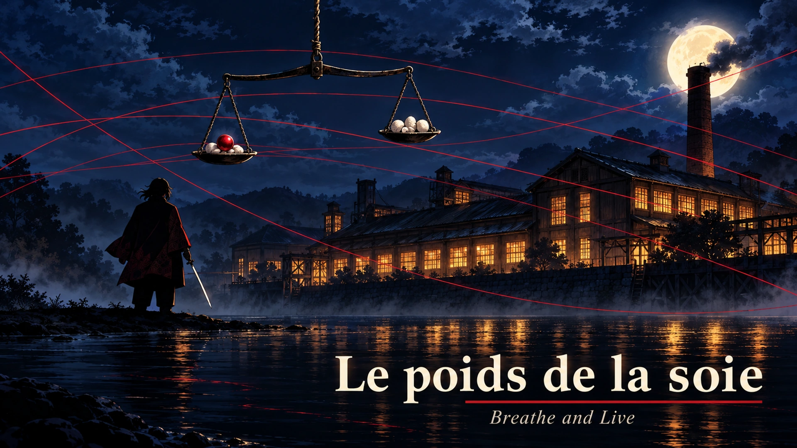

# Le poids de la soie



One-shot **Kimetsu no Yaiba** pour le système **Breathe and Live** sur Foundry VTT : cinq pourfendeurs Mizunoto, une filature en grève, et un démon qui pèse les vies humaines avec des contrepoids marqués de son sang. Comptez 3 à 4 heures de jeu.

## Prérequis

| | Version |
|---|---|
| Foundry VTT | 14 (vérifié en 14.368) |
| Système Breathe and Live | 0.6.0 ou plus récent |

## Installation

Dans Foundry : **Modules complémentaires → Installer un module**, puis collez l'URL du manifeste :

```
https://github.com/PrevotYann/le-poids-de-la-soie/releases/latest/download/module.json
```

Foundry vérifie ensuite les mises à jour tout seul : **Modules complémentaires → Rechercher les mises à jour** installe la dernière version publiée.

## Lancer le scénario

1. Activez le module dans votre monde Breathe and Live.
2. À la première connexion, le module propose d'importer l'aventure (sinon : compendium **Le poids de la soie — aventure**, puis **Importer**).
3. Tout arrive dans un dossier **Le poids de la soie** de chaque onglet : acteurs, objets, journaux, scène et macros.
4. Ouvrez le journal **Le poids de la soie — Guide du MJ**, page *Démarrage rapide*.

## Contenu

- **Cinq prétirés** prêts à jouer (Eau, Flamme, Foudre, Fleur, Vent) avec les formes, talents, sens, armes et soins du système 0.6.
- **PNJ** : Tamaki, Fumi, Gen, Chiyo, les huit ouvrières captives, Goro (combat d'initiation) et Shigure, le démon peseur.
- **Battlemap illustrée** de la filature Minase : murs, portes verrouillées, éclairages, pastilles A-F liées aux descriptions de zones.
- **Journaux** : guide du MJ scène par scène (textes à lire, tableaux de décisions), lieux, aide des joueurs, fiches d'identité des prétirés, pièces à remettre illustrées et PDF imprimables d'origine.
- **Tableau de bord MJ** (macro *Soie · Tableau de bord*) : la jauge de Pression avance seule à chaque fin de round du final, un contrepoids ramené à 0 PV libère sa zone, la vanne et les engagements obtenus en scène 3 sont suivis, et les arts à distance de Shigure se désactivent quand le réseau est coupé.
- **Portraits, tokens, icônes et illustrations** originaux : personnages dans le style anime de Kimetsu no Yaiba, accessoires et carte repeints en conservant les designs d'origine.

La 2.1 conserve les chemins et les dimensions des images : les mondes déjà importés bénéficient des nouveaux visuels après mise à jour du module. Les murs, portes, placements, pièces à remettre et PDF restent identiques.

## Mise à jour depuis la version 1.x

La 2.0 remplace les cinq compendiums de la 1.x par une seule aventure. Les documents déjà importés depuis la 1.x ne sont pas modifiés : supprimez-les ou rangez-les avant d'importer la 2.0 pour éviter les doublons.

## Développement

```bash
npm install
npm run art       # dérive tokens, miniatures, bannière et plan des illustrations conservées
npm run build     # reconstruit packs/aventure depuis src/
npm run validate  # vérifie dimensions, alpha, références du pack, scène et handouts
npm run release:check # vérifie versions, URLs et notes de version
npm run release   # prépare dist/le-poids-de-la-soie.zip et dist/module.json
npm run qa        # test complet sur un serveur Foundry 14 local (monde soie-qa)
```

Le build lit les données du système dans `../breathe-and-live` (ou `BL_SYSTEM_PATH`) pour embarquer ses formes, armes et talents à l'identique.

Les peintures de la 2.1 ont été créées avec l'outil intégré `image_gen.imagegen`, à partir des visuels précédents. Le jeu de prompts et les références sont dans [`tools/art/prompts.json`](tools/art/prompts.json). Les WebP finaux sont versionnés dans `assets/` ; la source commune des contrepoids est dans `tools/art/counterweight.webp`. `npm run art` ne nécessite aucun appel de génération ni clé API et ne touche pas aux handouts. Les anciens générateurs procéduraux restent disponibles comme référence dans `tools/art/`, sans être appelés par cette commande.

`npm run qa` attend un serveur Foundry 14 sur `localhost:30017` (ou `FOUNDRY_QA_URL`) avec un monde jetable `soie-qa`, le système et `dist/le-poids-de-la-soie` installés ; il importe l'aventure, vérifie dossiers, fiches, scène, images, jets et automatisations, puis enregistre des captures dans `test-results/`.

**Publier une version** : synchronisez la version dans `module.json`, `package.json` et `package-lock.json`, adaptez l'URL `download` et ajoutez les notes au `CHANGELOG.md`. Reconstruisez le compendium avec `npm run build`, vérifiez avec `npm run validate` et `npm run release:check`, puis poussez le changement du manifeste sur `main`. Le workflow crée automatiquement le tag `vX.Y.Z` sur ce commit et publie l'archive, le manifeste et la somme SHA-256 après vérification. Pour cette mise à jour, il publiera **v2.1.0**. Le lien `releases/latest` permet ensuite les mises à jour Foundry.

Un tag `vX.Y.Z` poussé manuellement ou le bouton **Run workflow** déclenchent aussi la publication. Le workflow ignore les versions déjà publiées, reprend une release restée en brouillon et refuse un tag existant qui ne correspond pas au commit à empaqueter. Il utilise le `GITHUB_TOKEN` fourni par GitHub Actions avec le droit d'écriture sur les contenus, sans secret supplémentaire.

## Licence

Code sous licence MIT. Scénario de fan non officiel, sans affiliation : Kimetsu no Yaiba appartient à Koyoharu Gotouge et à ses ayants droit. Les illustrations du module sont originales.
